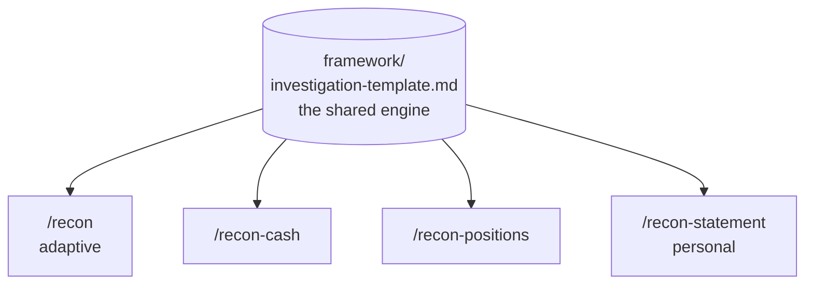

# ReconKit

**A reconciliation break investigator for Claude Code.** Paste two sources that
don't agree — a ledger and a bank statement, your book and a custodian's, or your
own bank statement against your memory — and it classifies the break, works the
root cause, and writes the finding. One adaptive engine, four presets, plus two
offline tools.

<p>


</p>

---

## Why this exists

Reconciliation is the same core loop everywhere: two sources disagree, and
someone has to figure out *why* — is it timing, a fee, a duplicate, a missing
entry, a bad price? But the **method differs by firm, by file, and by person**,
so a rigid "one true way" tool is useless.

ReconKit solves that by separating the **thinking** from the **specifics**. There's
one investigation engine (classify → evidence → root cause → write-up), and thin
presets that tune it for the recon you're actually doing — including a fully
adaptive mode that works with *any* file and *your* method.

## The tools

| Command | For |
|---|---|
| **`/recon`** | **Adaptive** — paste any two sources and describe how you reconcile. Works with any format and method. |
| **`/recon-cash`** | Cash rec: your ledger vs a bank/custodian balance. Tuned for timing, fees, FX, unrecorded items, duplicates. |
| **`/recon-positions`** | Position rec: internal holdings vs custodian. Tuned for quantity, settlement timing, price, corporate actions. |
| **`/recon-statement`** | **Personal** — your own bank/card statement. Catches double charges, missed refunds, subscription creep, sneaky fees, fraud. No finance background needed. |

Plus two **offline** helpers (no AI, no internet, no cost):

- **`tools/Reconciliation_Checklist_Tool.xlsx`** — a formula-only break-logging
  workbook that opens in any copy of Excel.
- **`tools/vba_generator.py`** — generates ready-to-paste VBA macros for common
  Excel recon tasks (compare two sheets and flag mismatches, highlight
  duplicates, clean data, export CSV, group-by summaries).

## How it works



One engine, four thin presets. The presets don't reinvent anything — they point
at the same five-step investigation and just tune *which break types to look for*
and *what vocabulary to use*. That's the whole trick: adaptable, not rigid.

## Quickstart

**Prerequisite:** [Claude Code](https://www.anthropic.com/claude-code).

```bash
git clone https://github.com/amrishtangri/reconkit.git
cd reconkit
claude
```

Then, inside Claude Code:

```
/recon-cash        then paste examples/sample-cash-break.md
/recon-statement   then paste examples/sample-statement.csv
/recon             for anything else — paste your two sources + your method
```

The `examples/` folder has a fictional cash break and a fictional statement so you
can watch it work before using your own data.

## Privacy & safety

- **Your financial data never gets committed.** Every `.csv`, `.xlsx`, `.pdf`, and
  generated report is git-ignored. The repo ships with fictional examples only.
- **It reasons only over what you paste** — it connects to no bank, custodian, or
  internal system.
- **It won't invent transactions.** If the data is too thin to conclude, it says
  what's missing instead of guessing.
- Reconciling employer data? Follow your own organization's data-handling policy
  for what you paste into any AI tool.

## Roadmap

- [ ] Intercompany and AR/AP aging presets.
- [ ] A "reconciliation summary" that rolls up many breaks into one report.
- [ ] CSV auto-column-mapping so you don't have to describe the layout.

## Contributing

Reconciliation methods vary — that's the point. If your recon type isn't covered,
a new preset is a great PR. Example files for different break types are welcome too.

## License

[MIT](LICENSE) — free to use, modify, and share.

---

<sub>Built with [Claude Code](https://www.anthropic.com/claude-code). The tools are
Markdown command files in `.claude/commands/` reading one shared framework —
readable, forkable, and easy to adapt to your own reconciliation.</sub>
